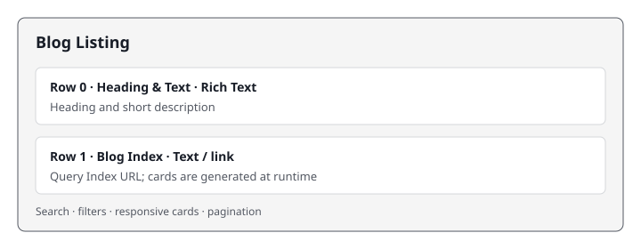

# Blog Listing

Displays searchable, filterable Blog, Video, and Podcast cards from the Blog Index.

## Universal Editor — Authoring View

The diagram below shows the two authored fields. Cards are generated from the index or temporary fallback data.



## Authoring

| Field | Type | Description |
|---|---|---|
| Heading & Text | Rich Text | Heading and short description shown above the listing. |
| Blog Index | Text | Query Index path used to load card data. |

## Responsive Behaviour

| Breakpoint | Behaviour |
|---|---|
| Mobile (< 600px) | One 328px card column, three cards per page, compact pagination. |
| Tablet (600–899px) | Two card columns, six cards per page. |
| Desktop (≥ 900px) | Four 260px card columns, eight cards per page; filter chips appear above the grid. |

Search and filters reset pagination. If the index request fails, eight temporary sample cards use the same renderer and remain searchable and filterable. The live index replaces them automatically when a retry succeeds.

## File Structure

```text
blocks/blog-listing/
├── blog-listing.js
├── blog-listing.css
├── _blog-listing.json
├── README.md
├── MAPPING-README.md
├── blog-listing-blog.png
├── blog-listing-video.png
├── blog-listing-podcast.png
├── blog-listing-savings-mobile.svg
└── docs/
    └── ue-authoring.svg
```